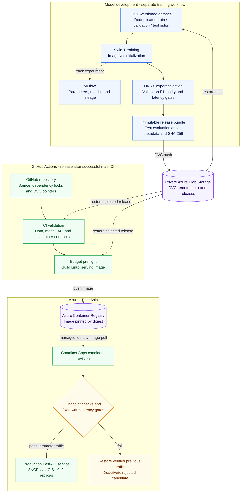
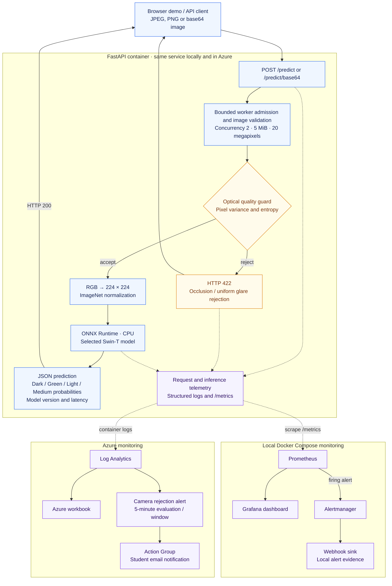

# Coffee Bean Roast Classification API — ITCS355

Group Idea: **6688218 Peerawat** and **6688230 Yongyot**. Private repository: [PPwStDy/coffee-bean-roast-capstone](https://github.com/PPwStDy/coffee-bean-roast-capstone).

An image-level classifier using the **Iteration4 Swin-T architecture** with the fixed class order **Dark, Green, Light, Medium**. Green means unroasted. The API returns four probabilities and rejects covered-camera or overexposed uniform frames before inference.

The revised roast scope requires instructor approval. See the [requirement checklist](reports/requirements_checklist.md) for actual completion evidence and pending academic milestones.

## Architecture

The system trains and versions a roast classifier separately from the API release pipeline. The selected model is packaged inside the serving image, so prediction requests use the local artifact in the container.

### Model and deployment pipeline



GitHub Actions authenticates to Azure through OIDC. The release pipeline restores the selected artifact without retraining; its warm latency gate uses the frozen targets in [`monitoring/slo.json`](monitoring/slo.json) when that file exists. Existing production traffic stays on the previous revision while a candidate is checked.

### Serving and observability



Dashed arrows show telemetry or experiment tracking. `/health` reports liveness; `/ready` checks the loaded model, metadata and artifact hashes. Local alerts go to the webhook sink; cloud alerts use the email Action Group. Alert configuration and actual recipient delivery are tracked as separate evidence.

See the [detailed architecture](reports/architecture.md) for model lineage, measurement boundaries and resource ownership.

## Data and model

The supplied 1,600 images contain 406 exact duplicate copies. All 400 images in the original test directory duplicate images in the original training directory. The imported Iteration4 checkpoint and its 99.75% result are preserved as a historical baseline; that result does not establish unseen-image performance.

The corrected seed 42 stratified splits contain **835 train / 178 validation / 181 test** images. The manifest records original sources, file and pixel hashes, duplicate groups and assignments. Contracts reject unreadable images, changed hashes, incorrect labels and exact duplicates across all splits.

Data sources are the version 1 Kaggle datasets by Gerry (gpiosenka) and Sakdipat Ontoum (sot2542), under **CC BY-SA 4.0**. Attribution, modifications and the requested Coffee Roast Intelligence citation are in [DATA_LICENSE.md](DATA_LICENSE.md). This license statement concerns dataset images; it does not claim that the weights inherit the same license.

The automated training procedure starts Swin-T from ImageNet weights, keeps Iteration4 augmentation and optimizer choices, records its actual source commit and locked dependency hash, and chooses the lowest validation-loss checkpoint. Batch 8 reduces memory pressure on the 8 GiB M1. Float and dynamic INT8 exports are compared using the complete validation split; the fastest median candidate with no more than a one percentage-point macro-F1 drop and passing parity is selected. Only that release is evaluated on the test split, once. See the immutable release bundle and [model card](reports/model_card.md) for measured results.

## Clean checkout

Prerequisites: Git, Python 3.12, uv 0.12.10, Azure CLI and Docker for container operations. Training on MPS is optional; CPU is supported and slower. Authentication is separate from the repository; never commit `cloud.env` or credentials.

```bash
git clone https://github.com/PPwStDy/coffee-bean-roast-capstone.git
cd coffee-bean-roast-capstone
uv sync --frozen
cp cloud.env.example cloud.env
# Fill the deployment configuration and sign into the authorized Azure subscription.
az login
az account set --subscription 6638a4ea-96da-4326-969a-2e40305cfc83
uv run --frozen dvc pull data/coffee_bean_roast.dvc models/iteration4_swin.pth.dvc releases/*.dvc
uv run --frozen python scripts/restore_release.py
uv run --frozen python -m scripts.release_integrity
make serve
```

The checked-in DVC remote is private Azure Blob storage. Access requires Storage Blob Data Reader (restoration) or Contributor (upload) on the capstone storage account. After teardown the remote must be provisioned and repopulated before these commands work; keep the local DVC cache and release bundle. Evidence records distinguish restoration while the remote existed from its eventual deletion.

To reproduce training, check out the recorded training commit and its dependency lock, restore the recorded dataset revision, and run:

```bash
uv sync --frozen
MODEL_VERSION=roast-swin-new-run uv run --frozen python -m src.train --epochs 20 --batch-size 8 --seed 42
MODEL_VERSION=roast-swin-new-run uv run --frozen python -m src.export_onnx --evaluate-test
```

Use a new model version for each independently trained release. Export refuses to repeat a test evaluation for an existing release. Seeds support reproducibility; identical MPS floating-point results are not guaranteed. Training is a separate workflow; PR validation restores the selected release and does not retrain.

The delivered model is already trained. Its recorded run used `roast-swin-retrained-v1`; the commands above demonstrate a future independent run and are not needed to serve it.

## API contract

Interactive documentation: [localhost:8080/docs](http://localhost:8080/docs).

### Presentation demo

Open `/demo/` on the same host as the API (for a local run, start `make serve` and visit
`http://localhost:8080/demo/`). The page includes four attributed sample images, drag-and-drop
JPEG/PNG upload, live class probabilities, model version and latency, and a clear optical-guard
rejection state. It calls the same-origin API, so no extra CORS configuration or frontend service
is required. The built-in samples are validation fixtures, not independent test examples; see
[`DATA_LICENSE.md`](DATA_LICENSE.md) for attribution and license details.

The **Follow the request** inspector shows the request ID, HTTP status, model version, optical
guard values, raw response JSON and three separate timing boundaries: browser round trip,
server request duration from `Server-Timing`, and scoring (guard, preprocessing and inference).
Black/white frame examples demonstrate rejection before inference. Current engine, concurrency
and guard thresholds come from `/ready` and `/demo-config`.

Use the source selector to explore a representative recorded CI log sample, or open a JSON,
JSONL or mixed service log file. Azure records with escaped JSON in `Log_s` are supported.
Imports stay in the browser; session observations can be searched, filtered and exported.
The cloud benchmark and log-summary cards are a checked-in historical snapshot with source
paths, separate from live requests. To check the log parser, run `node --test tests/test_demo_logs.cjs`.

| Route | Request / purpose |
|---|---|
| `POST /predict` | Raw JPEG/PNG bytes or multipart field `file` |
| `POST /predict/base64` | JSON `{"image_base64":"..."}` with strict base64 |
| `GET /health` | Process liveness |
| `GET /ready` | Loaded model and all compatibility checks; 503 when invalid |
| `GET /metrics` | Prometheus request, error, latency, prediction and anomaly metrics |

Decoded images are limited to 5 MiB and 20 megapixels. Unsupported formats return 415; oversized images 413; unreadable images 400; malformed schema 422; optical rejection 422; unavailable model or exhausted bounded inference capacity 503. All four probabilities must be finite, class IDs 0–3 must match the fixed order, and `X-Model-Version` must match the body. Inference runs in worker threads behind concurrency 2 rather than blocking the asynchronous request loop. Readiness requires matching architecture, classes, preprocessing, model version and artifact SHA-256.

```bash
curl --data-binary @tests/fixtures/Medium.png -H 'Content-Type: image/png' http://localhost:8080/predict
```

## Validation, deployment and monitoring

```bash
make lint
make portability-audit
make test
make cloud-check
make budget-check
make release-check
make failure-drill
make monitor-up
make trigger-alert
make monitor-down
```

The [Azure plan](.azure/plan.md) and Bicep provision a dedicated East Asia group tagged `course=itcs355`, `student=6688218`, `lab=capstone`. The application uses a digest-pinned Linux image, managed identity, 2 vCPU/4 GiB, HTTP scaling with min 0/max 2 and GitHub OIDC. CI checks lint, provider portability, data, model behavior, API handling, release integrity, optical guard regression and container integration. A successful main validation triggers candidate deployment, endpoint checks, frozen performance gates when available, traffic promotion or rollback.

Local Prometheus/Grafana/Alertmanager are retained. Azure Log Analytics and a workbook use escaped JSON application logs. A five-minute camera-occlusion rule routes to the signed-in student's email action group. Configuration alone does not prove email delivery; the checklist requires a receipt.

Initial targets require 1,000 warm requests at concurrency 2 and 20 cold-start trials with zero replicas verified before each request. Targets are measured p95/p99 plus 20%, rounded upward, then stored in `monitoring/slo.json`. Later releases enforce these fixed targets. Container bytes are recorded separately. Historical 120/250 ms and 2-second claims are withdrawn until measured evidence supports replacements.

## Costs and cleanup

[Cost report](reports/cost_report.md) separates serving, storage, registry, monitoring and training. The deployment gate uses actual prior subscription spending, dated East Asia prices and a dated USD/THB exchange rate against the remaining 800 THB course allowance. Free grants are excluded conservatively. Budget notifications are configured at 50/80/100%; notifications are not a hard spending cap.

`make cloud-teardown` verifies ownership before deleting only capstone resources and verifies preservation of the shared Azure ML workspace. At the user's request, the live API and DVC remote remain available until October 18. The scheduled cleanup is due at 13:17 UTC / 20:17 Bangkok that day, subject to GitHub scheduling delays. Actual deletion evidence remains pending until the cleanup verifies it. Owner cleanup of the exact capstone subscription budget and external role assignments is recorded separately; no shared workspace or unrelated lab resource is deleted.

After group deletion, the subscription owner runs `uv run --frozen python -m cloudlayer.cleanup_external` to remove the exact recorded capstone budget and two external role grants. The CI identity has no subscription-wide permission to remove those objects.

## Submission

The comprehensive report, revised proposal, one-page model card, slides and eight-minute demonstration script are maintained with evidence. The instructor's scope approval, architecture review, live presentation/Q&A and final submission remain pending until they actually happen. Model accuracy carries no capstone marks; reproducible operations and honest evidence are the focus.

### Recorded benchmark and fixed targets

The initial GitHub runner benchmark completed 1,000 requests at concurrency two: p95 240.64 ms, p99 250.66 ms. Twenty natural zero-replica cold trials measured p95 28.9509 s and p99 28.9945 s. Fixed limits are **289/301 ms warm** and **34.741/34.794 s cold**. Initial container size: **164,650,776 bytes**, reported separately. The GitHub runner and Bangkok Mac measurements are distinct network boundaries. `--resume` resumes only an incomplete cold run; later benchmarks collect fresh trials and enforce the existing targets.
