# Coffee roast capstone architecture

The service classifies an entire image into **Dark, Green, Light, Medium**. Green is unroasted. The dedicated capstone group is in East Asia; the existing Azure ML workspace belongs to the surrounding lab.

```mermaid
flowchart LR
    Repo[Private GitHub repository] --> CI[CI: contracts, exports, optical regression and container]
    Blob[Private Blob DVC remote] --> Restore[Clean checkout restoration]
    Restore --> Train[Separate training procedure: ImageNet Swin-T]
    Train --> Select[Validation loss and export comparison]
    Select --> Test[Selected release: test evaluation once]
    Test --> Bundle[Immutable release bundle and hashes]
    Bundle --> Blob
    Bundle --> ML[Shared Azure ML registry]
    CI --> Build[Linux image build]
    Bundle --> Build
    Build --> ACR[Private ACR]
    ACR --> Candidate[Candidate revision: zero traffic]
    Candidate --> Checks[Endpoint checks and fixed warm latency gates]
    Checks --> Traffic[Promote or restore verified traffic]
    Traffic --> API[Container Apps: 2 vCPU / 4 GiB, min 0 / max 2]
    Client[Image request] --> API
    API --> Guard[JPEG/PNG, size, dimensions and optical guard]
    Guard --> Infer[Bounded worker inference: selected INT8 ONNX]
    Guard --> Logs[Structured logs and counters]
    Infer --> Logs
    Logs --> Azure[Log Analytics and Azure workbook]
    Azure --> Rule[Camera rejection alert]
    Rule --> Email[Verified student email action group]
    Logs --> Local[Local Prometheus / Grafana / Alertmanager]
```

## Release and measurement boundaries

- The training commit, DVC revision, seed, initialization and dependency lock are recorded in model metadata. Serving code can change without changing the trained model.
- GitHub OIDC authenticates CI; a runtime managed identity pulls from ACR. Credentials are absent from the repository.
- Warm latency includes HTTP/network time from the GitHub Ubuntu runner. The Bangkok Mac measurement is retained separately; its measurements do not replace the fixed release baseline.
- Cold trials use the Bangkok Mac and require a management-plane response showing zero replicas before each prediction. Management queries do not wake the serving endpoint.
- Local Docker on the M1 and deployed Azure CPU measurements have different execution environments. The local dashboard reports its own telemetry; the fixed cloud warm gate runs during candidate validation.
- A real alert firing, action execution and recipient mailbox delivery are recorded separately. Test-notification support is restricted by the student subscription; that restriction alone does not prove real email delivery failed.
- The forecast gate, 50/80/100% budget notifications and scoped cleanup protect the remaining course allowance. Registry, Blob and monitoring have costs while the API is scaled to zero.

## Ownership and lifecycle

All deployed capstone resources carry `course=itcs355`, `student=6688218`, `lab=capstone`. Cleanup accepts only `rg-itcs355-6688218-capstone`, verifies ownership and records deletion. The shared Azure ML workspace and unrelated lab resources are preserved. Restoration evidence was captured while the private DVC remote existed; an intentionally retired remote must be reprovisioned and populated from retained data before a new remote restoration.
